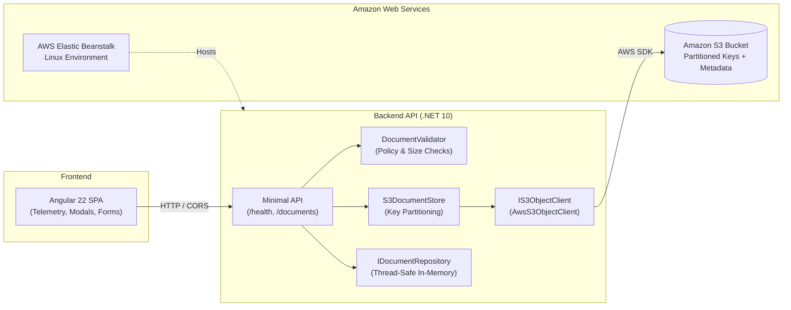

# Wp1Fall26Aws - Cloud Document Storage System

[](.github/workflows/ci.yml)
[](https://dotnet.microsoft.com/)
[](https://angular.dev/)
[](https://aws.amazon.com/)
[](#)

A production-grade, cloud-connected document storage platform built with **ASP.NET Core (.NET 10 Minimal APIs)** and **Amazon Simple Storage Service (S3)**, paired with a modern **Angular 22** Single-Page Application (SPA) consumer client demonstrating full RESTful CRUD capabilities (GET, POST, PUT, DELETE).

---

## Architecture at a Glance



---

## Documentation Index

Explore the dedicated documentation in the [`docs/`](docs/) directory:

| Document | Description |
| :--- | :--- |
| **[System Architecture](docs/architecture.md)** | Detailed component architectures, sequence diagrams, S3 key partitioning, and data flows. |
| **[REST API Specification](docs/api-specification.md)** | Complete endpoint reference with request schemas, status codes, and `curl` examples. |
| **[CI/CD & Deployment Guide](docs/deployment-and-ci-cd.md)** | GitHub Actions workflows, AWS OIDC token exchange, and Elastic Beanstalk packaging. |
| **[Security & Testing Methodology](docs/security-and-testing.md)** | Credential isolation, threat mitigation, test doubles (Spies vs Fakes), and boundary testing. |
| **[Demonstration Video Script](docs/demo-guide.md)** | Step-by-step recording script and local verification walk-through. |
| **[Evidence Submission Template](docs/evidence-template.md)** | Submission checklist for S3 metadata, CI/CD run links, and IAM analysis. |
| **[Frontend Application Guide](consumer-app/README.md)** | Angular 22 architecture, standalone components, telemetry logging, and build scripts. |
| **[Testing Analysis Answers](Testing_Answers.txt)** | In-depth answers regarding zero-credential CI, test double safety, and shift-left testing. |

---

## API Routes and Resources

The ASP.NET Core API provides full RESTful endpoints with cross-origin resource sharing (CORS) enabled:

| HTTP Method | Route | Target Resource | Request Payload | Status Codes | Description |
| :--- | :--- | :--- | :--- | :--- | :--- |
| **GET** | `/health` | Service Health | *None* | `200 OK` | Liveness check returning `{ "status": "Healthy" }`. |
| **GET** | `/documents` | Document Collection | *None* | `200 OK` | Retrieves all stored document records, ordered newest first. |
| **GET** | `/documents/{id}` | Individual Document | *None* (ID or S3 Key in path) | `200 OK`<br>`404 Not Found` | Retrieves metadata for an individual document. |
| **POST** | `/documents` | Document Collection | **Multipart Form:** `file` (binary, max 1 MiB), `title` (optional), `description` (optional)<br>— OR —<br>**JSON:** `title`, `description`, `fileName`, `contentType`, `content` | `201 Created`<br>`400 Bad Request`<br>`500 Server Error` | Uploads file stream to Amazon S3 with custom metadata headers and indexes the record. |
| **PUT** | `/documents/{id}` | Individual Document | **JSON:** `title` (required), `description` (optional) | `200 OK`<br>`400 Bad Request`<br>`404 Not Found` | Updates editable metadata fields (`Title`, `Description`) and updates `UpdatedUtc`. |
| **DELETE** | `/documents/{id}` | Individual Document | *None* (ID in path) | `200 OK`<br>`404 Not Found` | Removes a document record from the repository index. |

---

## Running Locally

### Prerequisites
* [.NET 10 SDK](https://dotnet.microsoft.com/)
* [Node.js 20 LTS+](https://nodejs.org/) & `npm`

### 1. Run the ASP.NET Core API
```powershell
dotnet run --project src/Wp1Fall26Aws.Api --urls "http://localhost:5180"
```
The API listens at `http://localhost:5180`. When running without AWS credentials configured, the API automatically uses a safe local mock client.

### 2. Run the Angular Consumer App
```powershell
cd consumer-app
npm install
npm start
```
The client serves at `http://localhost:4200` with live reloading, connected to `http://localhost:5180`.

### 3. Interactive HTTP Requests
A ready-to-run HTTP scratchpad is available in [`src/Wp1Fall26Aws.Api/Wp1Fall26Aws.Api.http`](src/Wp1Fall26Aws.Api/Wp1Fall26Aws.Api.http) for testing endpoints directly in VS Code or Visual Studio.

---

## Amazon S3 Storage Configuration

Uploaded files are validated at the API boundary and streamed directly to Amazon S3:

### Validation Constraints
* **Maximum File Size:** 1 MiB (`1,048,576` bytes)
* **Allowed Extensions:** `.txt`, `.pdf`, `.png`, `.jpg`, `.jpeg` (case-insensitive)
* **Allowed Content Types:** `text/plain`, `application/pdf`, `image/png`, `image/jpeg`
* **Zero-byte Files:** Rejected immediately (`400 Bad Request`)

### Object Key Partitioning
Keys are structured chronologically to ensure even bucket partitioning and zero key collisions:
```text
{KeyPrefix}/{yyyy}/{MM}/{dd}/{guid:N}{.extension}
```
*Example:* `documents/uploads/2026/10/16/e2b4f91d08ac433ab9938b29df910041.pdf`

### AWS Configuration Keys
Stored under the `S3Storage` section in `appsettings.json` or `.NET User Secrets`:
* `S3Storage:BucketName`
* `S3Storage:KeyPrefix` (defaults to `documents/uploads`)
* `S3Storage:Region` (defaults to `us-east-1`)
* `S3Storage:MaxFileSizeBytes` (defaults to `1048576`)

To configure AWS S3 for local testing:
```bash
dotnet user-secrets --project src/Wp1Fall26Aws.Api set "S3Storage:BucketName" "<your-bucket-name>"
```

---

## Automated Test Suite

The solution features a comprehensive automated test suite covering input validation, boundary limits, test double spy verification, and end-to-end integration tests:

```powershell
dotnet test
```

### Test Suite Structure
* **`DocumentValidatorTests`**: Boundary checks (0-byte, exact 1 MiB pass, 1 byte over fail, extensions, MIME types, multiple errors).
* **`S3DocumentStoreTests`**: Key partitioning regex, collision prevention on identical filenames, metadata header propagation, short-circuit validation.
* **`DocumentApiTests`**: Integration tests using `WebApplicationFactory<Program>` validating real HTTP multipart uploads, Location headers, and full CRUD workflows.
* **Test Doubles**: Custom `RecordingS3ObjectClientSpy` and `FakeS3ObjectClient` providing zero-credential test execution.
