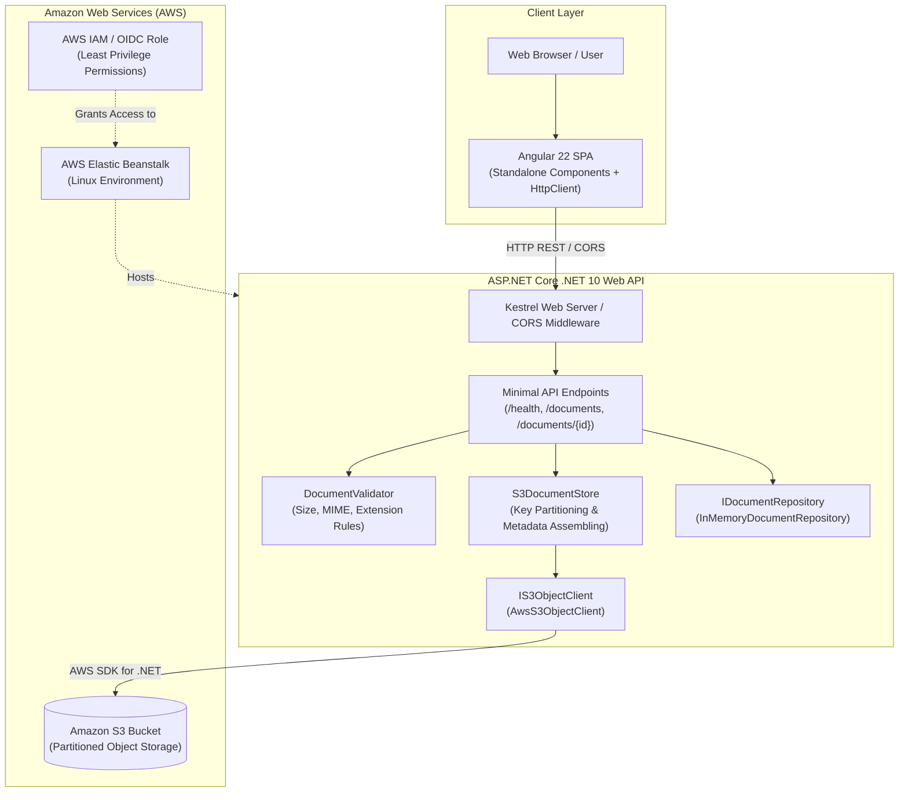
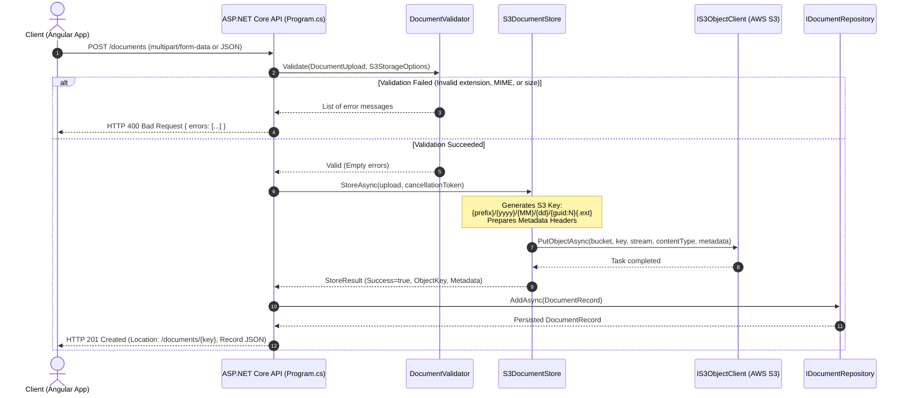
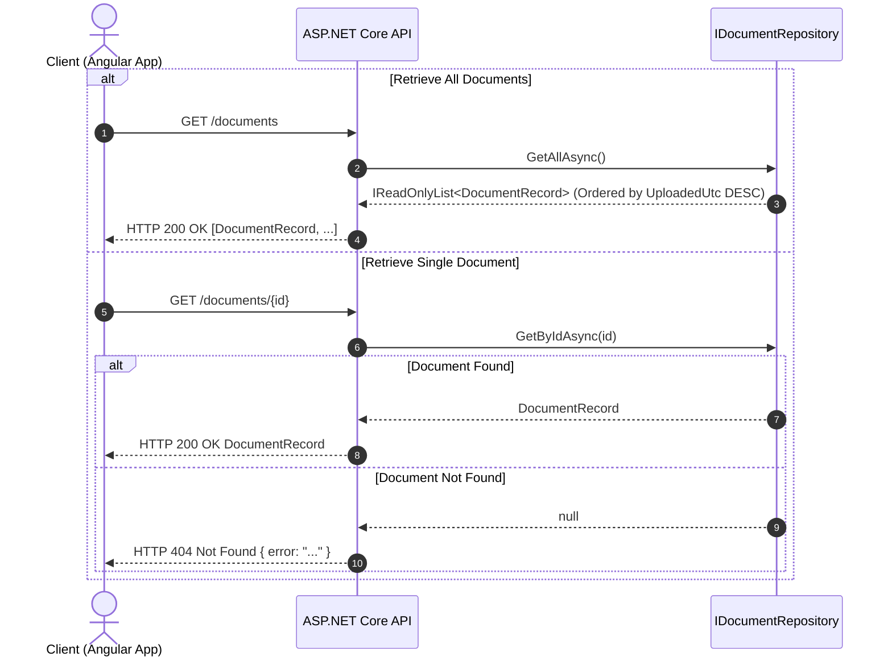
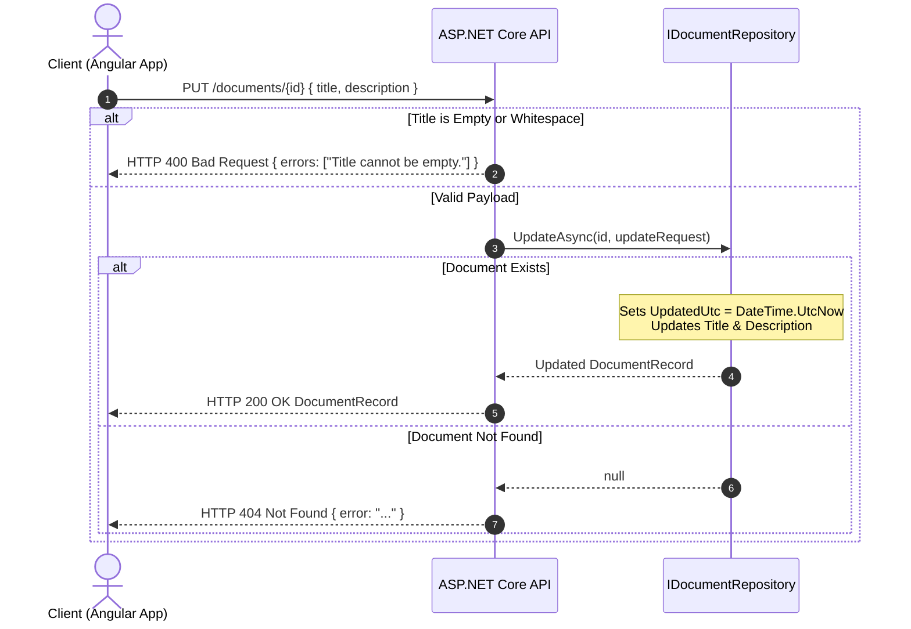
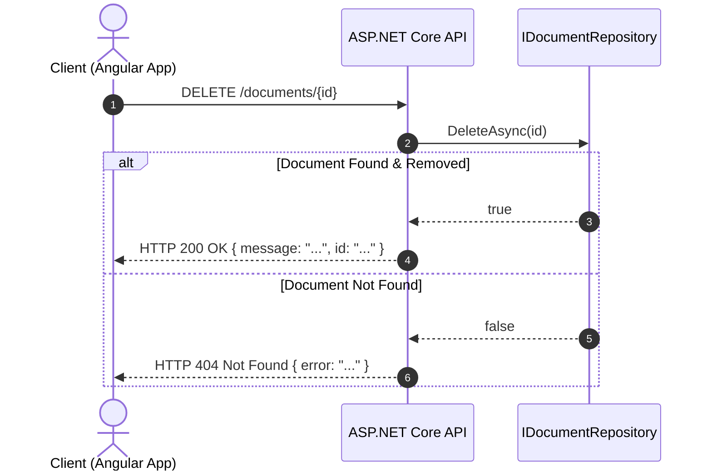

# System Architecture & Technical Design

## 1. Overview

**Wp1Fall26Aws** is a cloud-native document management platform designed for scalable, decoupled file storage on Amazon Web Services (AWS). It pairs a high-performance **ASP.NET Core (.NET 10)** REST API backend with an **Angular 22** Single-Page Application (SPA) frontend, leveraging **Amazon Simple Storage Service (S3)** for object persistence and an in-memory repository for rapid metadata indexing and demonstration.



---

## 2. Core Architectural Principles

1. **Separation of Concerns & Interface Decoupling**:
   - The application logic does not directly couple to the concrete AWS SDK. All S3 operations pass through the `IS3ObjectClient` boundary interface, enabling unit and integration tests to run with zero cloud credentials using test doubles (`RecordingS3ObjectClientSpy`, `FakeS3ObjectClient`).
2. **Boundary Validation First (Fail-Fast)**:
   - File uploads are thoroughly inspected by `DocumentValidator` before invoking downstream storage services. Invalid files (oversized, disallowed extension, prohibited MIME type, zero-length) are rejected immediately at the application boundary, preventing unnecessary network transfers and billable S3 operations.
3. **Partitioned, Collision-Free Object Storage**:
   - Files are stored in Amazon S3 using a date-partitioned, GUID-based key hierarchy. This guarantees horizontal scaling across S3 partitions and eliminates namespace collisions.
4. **Single-Page Application Co-hosting**:
   - The Angular consumer app is built into static assets inside `src/Wp1Fall26Aws.Api/wwwroot` and served directly by ASP.NET Core static file middleware, enabling a unified deployment artifact on AWS Elastic Beanstalk while preserving CORS flexibility for independent local development.

---

## 3. Data Flow & CRUD Operation Sequences

### 3.1. Document Creation / Upload (`POST /documents`)

The API supports both multipart form file uploads and raw JSON document creation:



### 3.2. Document Retrieval (`GET /documents` and `GET /documents/{id}`)



### 3.3. Document Metadata Update (`PUT /documents/{id}`)



### 3.4. Document Deletion (`DELETE /documents/{id}`)



---

## 4. Amazon S3 Storage Architecture

### 4.1. Hierarchical Key Partitioning Scheme

All uploaded objects are stored using a partitioned folder structure:

```text
{KeyPrefix}/{yyyy}/{MM}/{dd}/{guid:N}{.extension}
```

- **`KeyPrefix`**: Configurable root namespace (defaults to `documents/uploads`).
- **`{yyyy}/{MM}/{dd}`**: Year, month, and day based on UTC time of upload. This ensures that files are evenly distributed over time and provides natural chronological indexing in the S3 bucket.
- **`{guid:N}`**: A 32-character lowercase hexadecimal globally unique identifier (`N` format without hyphens), guaranteeing zero key collisions even with identical uploaded filenames.
- **`{.extension}`**: Lowercase file extension preserved from the original upload (e.g., `.txt`, `.pdf`, `.png`).

**Example Object Key:**
```text
documents/uploads/2026/10/16/e2b4f91d08ac433ab9938b29df910041.pdf
```

### 4.2. S3 Object Metadata Headers

When files are written to S3 via `PutObjectRequest`, the following user-defined metadata headers are persisted directly in the object header metadata:

| Metadata Header | Source | Description | Example |
| :--- | :--- | :--- | :--- |
| `original-filename` | `DocumentUpload.FileName` | Original name of the uploaded file | `project-spec.pdf` |
| `content-type` | `DocumentUpload.ContentType` | Validated MIME type | `application/pdf` |
| `uploaded-utc` | `DateTime.UtcNow.ToString("O")` | ISO 8601 UTC upload timestamp | `2026-10-16T15:30:00.0000000Z` |
| `content-length` | `DocumentUpload.ContentLength` | Byte size of the payload | `104857` |

---

## 5. Security Architecture

1. **GitHub Actions OpenID Connect (OIDC)**:
   - The deployment workflow (`.github/workflows/deploy.yml`) uses AWS OIDC identity federation instead of long-lived access keys (`AWS_ACCESS_KEY_ID` / `AWS_SECRET_ACCESS_KEY`).
   - GitHub generates a short-lived OIDC JWT token that is verified by AWS STS (`sts:AssumeRoleWithWebIdentity`), strictly scoped to repository and branch conditions.
2. **Credential Isolation in Pull Requests**:
   - The CI pipeline (`.github/workflows/ci.yml`) runs on all branches and pull requests without any AWS secrets or cloud access. All tests run against in-memory doubles (`RecordingS3ObjectClientSpy`, `FakeS3ObjectClient`).
3. **Boundary Input Sanitization**:
   - File extensions are normalized with `.ToLowerInvariant()`.
   - File size limits are enforced strictly up to `1,048,576` bytes (1 MiB).
   - Filenames are never used directly as raw S3 object keys; instead, keys are generated from synthetic date paths and GUIDs, protecting against directory traversal attacks (`../../`).
4. **Cross-Site Scripting (XSS) Prevention**:
   - The Angular frontend renders document titles, file names, and descriptions purely using Angular text interpolation expressions (`{{ doc.title }}`), avoiding any `innerHTML` or unescaped HTML injection.

---

## 6. Telemetry & Client Observability

The Angular client includes an integrated real-time HTTP activity and telemetry inspector:
- Captures HTTP method, target endpoint, status code, response time in milliseconds, and diagnostic message.
- Maintains a rolling circular buffer of the 30 most recent network transactions.
- Allows immediate verification of backend performance and contract adherence.
