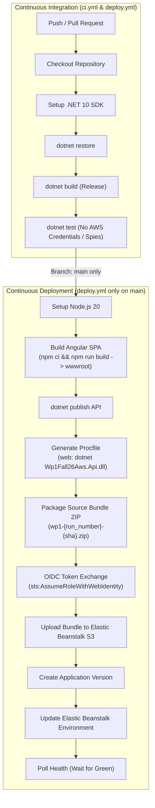

# CI/CD Pipeline & AWS Deployment Guide

This guide details the continuous integration (CI) and continuous deployment (CD) architecture for **Wp1Fall26Aws**, leveraging **GitHub Actions**, **AWS OpenID Connect (OIDC)**, and **AWS Elastic Beanstalk**.

---

## 1. Pipeline Architecture Overview



---

## 2. Continuous Integration (`ci.yml`)

The CI workflow runs on **every push to any branch** and on all pull requests targeting `main`.

### Workflow File: `.github/workflows/ci.yml`
```yaml
name: CI

on:
  push:
    branches:
      - '**'
  pull_request:
    branches:
      - main

jobs:
  build:
    runs-on: ubuntu-latest
    steps:
    - uses: actions/checkout@v3
    - name: Setup .NET
      uses: actions/setup-dotnet@v3
      with:
        dotnet-version: 10.0.x
    - name: Restore dependencies
      run: dotnet restore Wp1Fall26Aws.slnx
    - name: Build
      run: dotnet build Wp1Fall26Aws.slnx --no-restore
    - name: Test
      run: dotnet test Wp1Fall26Aws.slnx --no-build --verbosity normal
```

### Key Security & Reliability Principles:
- **Zero AWS Secrets Required**: The CI runner is completely unauthenticated to AWS.
- **Decoupled Test Doubles**: All S3 operations are handled by `RecordingS3ObjectClientSpy` and `FakeS3ObjectClient`.
- **Determinism**: Eliminates network latency, throttling, and intermittent AWS API outages from test runs.
- **Prevents Cost & Secret Leaks**: Untrusted external pull request code cannot access AWS infrastructure or generate cloud costs.

---

## 3. Continuous Deployment (`deploy.yml`)

The CD workflow triggers on pushes to `main` and manual `workflow_dispatch` executions. It enforces a strict two-stage process:

### Stage 1: `build-test`
Executes full compilation and tests against `.NET 10` in `Release` configuration. If any test fails, deployment immediately halts.

### Stage 2: `deploy` (Guarded: `main` branch only)
Requires `needs: build-test` and `github.ref == 'refs/heads/main'`.

#### 1. Frontend Asset Compilation
```bash
cd consumer-app
npm ci --legacy-peer-deps || npm install --legacy-peer-deps
npm run build
cd ..
```
The Angular build emits production bundles directly into `src/Wp1Fall26Aws.Api/wwwroot`.

#### 2. .NET Publish & Packaging
```bash
dotnet publish src/Wp1Fall26Aws.Api --configuration Release --output publish
echo "web: dotnet Wp1Fall26Aws.Api.dll --urls http://0.0.0.0:5000" > publish/Procfile
VERSION="${GITHUB_RUN_NUMBER}-${GITHUB_SHA::7}"
cd publish && zip -qr "../wp1-$VERSION.zip" . && cd ..
```
- **`Procfile`**: Instructs AWS Elastic Beanstalk Linux platform to launch the .NET process listening on port 5000 behind NGINX.
- **Artifact Bundle**: `wp1-{run_number}-{sha}.zip` containing all DLLs, compiled Angular assets, and `Procfile`.

#### 3. Secure AWS Authentication via OIDC
Instead of storing permanent AWS access keys in GitHub Secrets, the pipeline uses **GitHub OIDC Identity Federation**:

```yaml
permissions:
  contents: read
  id-token: write

steps:
  - name: Configure AWS credentials via OIDC
    uses: aws-actions/configure-aws-credentials@v4
    with:
      role-to-assume: ${{ vars.AWS_DEPLOY_ROLE }}
      role-session-name: wp1-deploy-${{ github.run_id }}
      aws-region: us-east-1
```

**How OIDC Works:**
1. The GitHub Actions runner requests a cryptographically signed JSON Web Token (JWT) from GitHub's OIDC provider.
2. The `aws-actions/configure-aws-credentials` action presents this token to AWS Security Token Service (STS).
3. AWS STS validates the signature, issuer (`https://token.actions.githubusercontent.com`), audience (`sts.amazonaws.com`), and repository claim (`repo:organization/repo:ref:refs/heads/main`).
4. Upon validation, STS issues temporary, scoped AWS credentials valid only for the duration of the job (typically 1 hour).

#### 4. Elastic Beanstalk Deployment & Health Polling
```bash
# 1. Upload source bundle to Elastic Beanstalk S3 bucket
aws s3 cp "$BUNDLE" "s3://$EB_BUCKET/$EB_APPLICATION/$BUNDLE"

# 2. Register application version
aws elasticbeanstalk create-application-version \
  --application-name "$EB_APPLICATION" \
  --version-label "$VERSION_LABEL" \
  --source-bundle "S3Bucket=$EB_BUCKET,S3Key=$EB_APPLICATION/$BUNDLE" \
  --description "${GITHUB_SHA::7} by ${GITHUB_ACTOR}"

# 3. Update environment to deploy the new version
aws elasticbeanstalk update-environment \
  --environment-name "$EB_ENVIRONMENT" \
  --version-label "$VERSION_LABEL"

# 4. Poll health until status is Ready and health is Green
for i in $(seq 1 40); do
  read -r STATUS HEALTH <<< "$(aws elasticbeanstalk describe-environments \
    --environment-names "$EB_ENVIRONMENT" \
    --query 'Environments[0].[Status,Health]' --output text)"
  if [ "$STATUS" = "Ready" ]; then
    [ "$HEALTH" = "Green" ] && { echo "Deployed."; exit 0; }
    aws elasticbeanstalk describe-events --environment-name "$EB_ENVIRONMENT" --max-items 15
    exit 1
  fi
  sleep 15
done
```

---

## 4. Configuration Keys & Environment Variables

| Variable / Key | Purpose | Example Value |
| :--- | :--- | :--- |
| `AWS_REGION` | Target AWS deployment region | `us-east-1` |
| `EB_APPLICATION` | Elastic Beanstalk application name | `wp1-fall26-aws` |
| `EB_ENVIRONMENT` | Elastic Beanstalk environment name | `wp1-fall26-aws-dev` |
| `vars.AWS_DEPLOY_ROLE` | AWS IAM Role ARN for OIDC assume-role | `arn:aws:iam::944036659002:role/GitHubDeployRole` |
| `S3Storage:BucketName` | Target S3 bucket for document uploads | `wp1-fall26-documents-bucket` |
| `S3Storage:KeyPrefix` | S3 key prefix namespace | `documents/uploads` |
| `S3Storage:MaxFileSizeBytes` | Upper boundary for file uploads | `1048576` (1 MiB) |

---

## 5. Local Development Configuration

When developing locally without AWS credentials, the application automatically uses mock AWS credentials (`local-dev-mock`) and safe boundary behavior.

To connect your local API to a real AWS S3 bucket:
```powershell
# 1. Set your AWS credentials in your terminal or AWS CLI profile
aws configure

# 2. Configure bucket name in .NET User Secrets
dotnet user-secrets --project src/Wp1Fall26Aws.Api set "S3Storage:BucketName" "<your-s3-bucket-name>"

# 3. Run the API
dotnet run --project src/Wp1Fall26Aws.Api --urls "http://localhost:5180"
```
