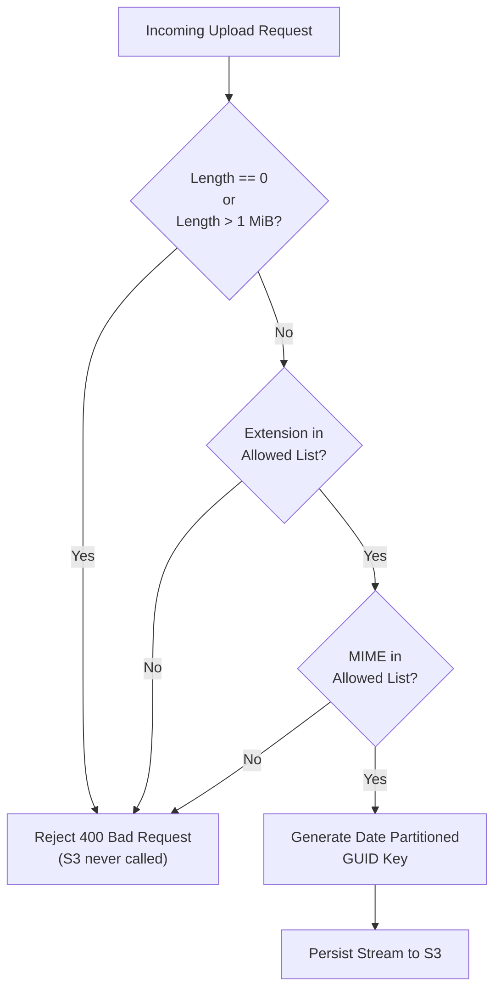

# Security Architecture & Testing Methodology

This document outlines the security architecture, threat model mitigations, and automated testing strategy implemented across the **Wp1Fall26Aws** solution.

---

## 1. Security Architecture & Threat Mitigation

### 1.1. Credential Isolation & Zero Trust

Modern secure development mandates that build and testing systems operate under the principle of **least privilege and zero trust**:

- **No Stored Static Credentials**: Long-lived access keys (`AWS_ACCESS_KEY_ID` / `AWS_SECRET_ACCESS_KEY`) are prohibited in GitHub Secrets. Compromised secrets in GitHub repositories have historically led to unauthorized resource creation and cryptocurrency mining.
- **Short-Lived OIDC Authentication**: Deployments request temporary credentials via AWS Security Token Service (STS) using OpenID Connect (OIDC). STS verifies GitHub's signed claims before granting role assumption.
- **Unauthenticated Pull Requests**: Pull requests run CI tests completely isolated from AWS. If an untrusted contributor submits a PR modifying tests or build scripts, they cannot access any AWS resources or exfiltrate secrets.

### 1.2. File Upload Defense-in-Depth

Untrusted file uploads represent a significant attack vector (malicious executable uploads, denial-of-service via huge files, storage exhaustion). The application enforces strict boundary controls:



1. **Size Enforcement**:
   - Files with 0 bytes are rejected immediately (`"File is empty."`).
   - Files exceeding `1,048,576` bytes (1 MiB) are rejected (`"File exceeds the maximum size of 1048576 bytes."`).
2. **Strict Extension Whitelist**:
   - Only `.txt`, `.pdf`, `.png`, `.jpg`, and `.jpeg` are permitted.
   - Executable formats (`.exe`, `.sh`, `.bat`, `.dll`, `.js`, `.py`) are strictly rejected.
   - Extension parsing is normalized using `.ToLowerInvariant()`, preventing bypasses such as `file.EXE` or `file.TxT`.
3. **MIME Content Type Whitelist**:
   - Content types are restricted to `text/plain`, `application/pdf`, `image/png`, and `image/jpeg`.
4. **Path Traversal & Overwrite Mitigation**:
   - User-supplied file names are **never** used to formulate the physical S3 object key.
   - Keys are generated programmatically using UTC date partitioning and random 32-character hexadecimal GUIDs:
     ```text
     {KeyPrefix}/{yyyy}/{MM}/{dd}/{guid:N}{.ext}
     ```
   - This eliminates directory traversal attacks (e.g. `../../etc/passwd` or `..\..\windows\system32`) and completely prevents malicious users from overwriting existing files in the bucket.

### 1.3. Cross-Site Scripting (XSS) Prevention

- Document titles, file names, descriptions, and metadata could contain malicious script tags (`<script>alert(1)</script>`).
- The Angular frontend renders all dynamic values using standard template binding (`{{ doc.title }}` and `{{ doc.description }}`), which automatically escapes HTML characters.
- Direct DOM injection through `[innerHTML]` is strictly avoided.

---

## 2. Testing Methodology & The Testing Pyramid

The project employs a multi-tiered testing strategy ensuring full coverage without requiring live cloud services:

```text
       ▲
      / \
     /   \     Integration Tests (DocumentApiTests)
    /-----\    - WebApplicationFactory<Program>
   /       \   - End-to-end HTTP pipeline, routes, serialization, CORS
  /---------\  
 /           \ Unit Tests (S3DocumentStoreTests, DocumentValidatorTests)
/_____________\ - Fast, deterministic, boundary assertions, spies & fakes
```

### 2.1. Test Double Patterns (Spies vs. Fakes)

Instead of relying on heavy mocking frameworks (e.g. Moq, NSubstitute) that can hide implementation details, the project uses handwritten test doubles implementing `IS3ObjectClient`:

#### 1. `RecordingS3ObjectClientSpy` (Test Spy)
- **Role**: Records the exact arguments of the most recent call to `PutObjectAsync`.
- **Usage**:
  ```csharp
  var spy = new RecordingS3ObjectClientSpy();
  var store = new S3DocumentStore(spy, Options.Create(options));
  await store.StoreAsync(upload);

  Assert.NotNull(spy.LastRequest);
  Assert.Equal("test.txt", spy.LastRequest.Metadata["original-filename"]);
  ```
- **Value**: Proves what metadata was forwarded to AWS. If validation fails, `Assert.Null(spy.LastRequest)` mathematically guarantees that zero network requests were made to S3.

#### 2. `FakeS3ObjectClient` (Test Fake)
- **Role**: Maintains an in-memory list of `Calls` across multiple sequential invocations.
- **Usage**: Used to verify key formatting regex, collision resistance on identical filenames, and call count verification (`Assert.Empty(fake.Calls)` on invalid files).

### 2.2. Unit Test Suites

#### `DocumentValidatorTests`
- `AcceptsValidSmallTxt`: Verifies a valid 100-byte text file passes without errors.
- `RejectsEmpty`: Verifies that a 0-byte stream is rejected.
- `RejectsOversize_PassesAtBoundary`: Explicit boundary verification:
  - Exactly `1,048,576` bytes (1 MiB) passes.
  - `1,048,577` bytes (1 byte over) is rejected.
- `RejectsExe`: Verifies rejection of `.exe` files.
- `RejectsDisallowedContentType`: Verifies rejection of disallowed MIME types.
- `AcceptsUppercasePdf`: Verifies case-insensitivity on uppercase extensions.
- `ReturnsMultipleErrors`: Verifies that multiple violations (e.g. bad extension + bad MIME + oversized) are collected and returned simultaneously.

#### `S3DocumentStoreTests`
- `KeyMatchesExpectedFormat`: Validates that generated S3 keys strictly conform to `^documents/uploads/\d{4}/\d{2}/\d{2}/[0-9a-f]{32}\.txt$`.
- `SameFilenameDifferentKeys`: Confirms two uploads with identical filenames receive unique GUID keys.
- `PassesConfiguredBucketAndMetadata`: Verifies that custom headers (`original-filename`, `content-type`, `uploaded-utc`, `content-length`) are correctly populated.
- `RejectedUploadCallsFakeZeroTimes`: Confirms rejected uploads short-circuit and never reach the storage client.
- `StoreAsync_ValidDocument_ReturnsSuccessAndCallsS3`: Confirms valid documents succeed and register with the spy.
- `StoreAsync_InvalidDocument_ReturnsFalseAndNeverCallsS3`: Confirms invalid documents fail and leave the spy untouched.

### 2.3. Integration Test Suite (`DocumentApiTests`)

Using `Microsoft.AspNetCore.Mvc.Testing.WebApplicationFactory<Program>`, integration tests start an in-memory test server executing the actual ASP.NET Core middleware, model binders, and routing pipeline:

- `PostDocuments_ValidFile_Returns201AndCallsS3`:
  - Posts a real `MultipartFormDataContent` payload to `/documents`.
  - Asserts HTTP status `201 Created`.
  - Asserts response header `Location` is present with the S3 object key.
  - Replaces `IS3ObjectClient` with `RecordingS3ObjectClientSpy` in DI to verify the boundary call occurred with metadata.
- `GetDocuments_Returns200WithList`:
  - Queries `GET /documents`.
  - Verifies HTTP `200 OK` and presence of seeded records.
- `PutDocument_ValidUpdate_Returns200WithUpdatedData`:
  - Executes `PUT /documents/doc-1` with updated title and description.
  - Verifies HTTP `200 OK` and returned modified entity.
- `DeleteDocument_ExistingItem_Returns200AndRemovesItem`:
  - Executes `DELETE /documents/doc-2`.
  - Verifies HTTP `200 OK`.
  - Verifies subsequent `GET /documents/doc-2` returns HTTP `404 Not Found`.

---

## 3. Running the Test Suite Locally

```powershell
# Run all tests in the solution
dotnet test

# Run tests with detailed test names and execution duration
dotnet test --verbosity normal

# Run tests with code coverage collection
dotnet test --collect:"XPlat Code Coverage"
```
